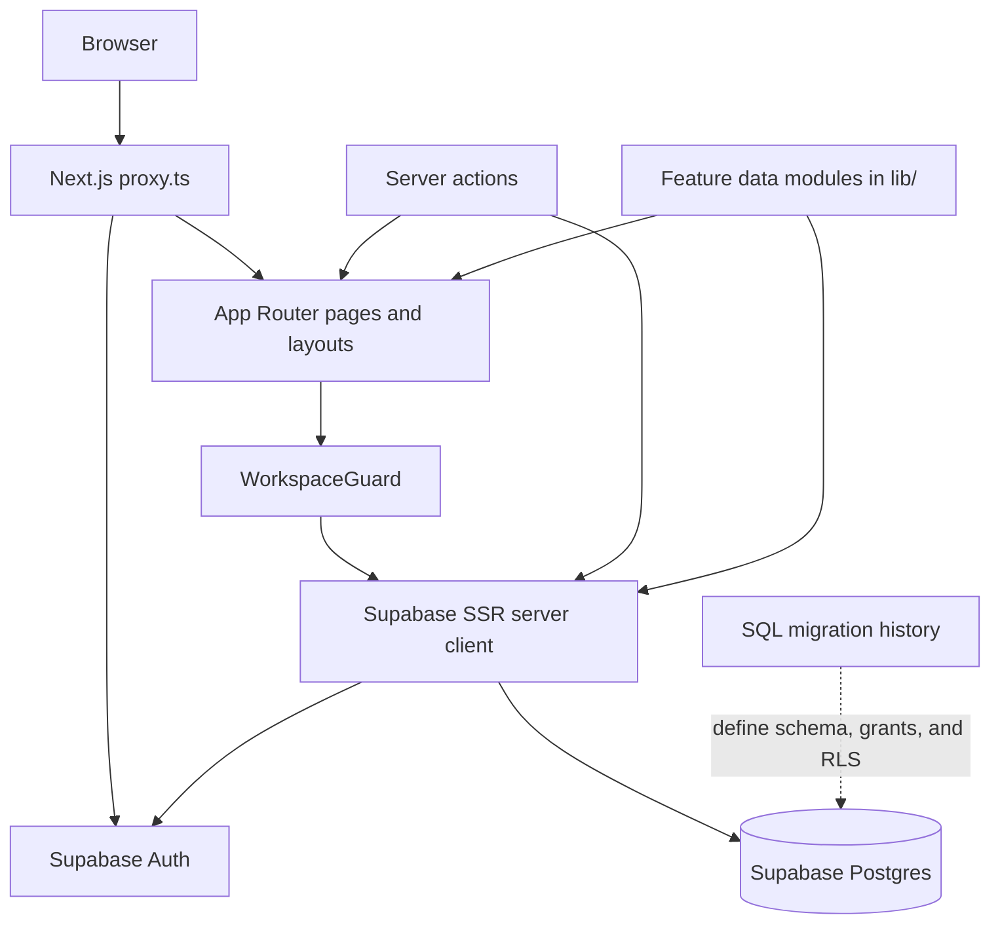

# SmartCampus Project Architecture

This document describes the repository as it currently exists. It is an
architecture inventory, not a proposed refactor: the web applications, C/C++
projects, configurations, environment files, and database migrations remain in
their current locations.

## Repository and project boundaries

The repository root is the primary SmartCampus web application. It contains a
Next.js App Router application, its Supabase integration and migrations, and
also a set of C/C++ educational project files.

There are additional independent project roots within the repository:

- `SmartCampusAssistant/Smart_Student_Web/` is a separate Next.js project with
  its own package manifest, lockfile, configuration, environment files, public
  assets, and Supabase migrations. It also contains a nested C/C++ student
  activity manager.
- `student-activity-manager/` is a separate C/C++ educational project with its
  own README, VS Code configuration, and `Phase1/` report assets. It also
  contains its own nested Next.js project at
  `student-activity-manager/Smart_Student_Web/`, with its own manifest,
  lockfile, configuration, and migrations.
- The root `Phase1/` contains project report and presentation assets.
- `Smart_Student_Web/WEB` is a small file with unclear purpose; it is retained
  as-is.

Although some files have identical contents across these roots, the roots have
different configurations, environments, and some differing files. Content
identity alone does not make these projects interchangeable. They should be
treated as separate project boundaries unless their owners and intended use
are confirmed.

## Current repository tree

The following is a representative tree of the root application. It omits
individual component files and generated/dependency directories for readability.

```text
smart-student-web/
├── app/
│   ├── (workspace)/
│   │   ├── attendance/page.tsx
│   │   ├── dashboard/page.tsx
│   │   ├── events/page.tsx
│   │   ├── exams/page.tsx
│   │   ├── library/page.tsx
│   │   ├── notifications/page.tsx
│   │   ├── placements/page.tsx
│   │   ├── profile/
│   │   ├── settings/page.tsx
│   │   ├── tasks/page.tsx
│   │   ├── layout.tsx
│   │   └── workspace-guard.tsx
│   ├── attendance/
│   │   ├── actions.ts
│   │   └── ui/attendance-manager.tsx
│   ├── auth/actions.ts
│   ├── components/
│   ├── exams/
│   │   ├── actions.ts
│   │   └── ui/exam-form.tsx
│   ├── library/
│   │   ├── actions.ts
│   │   └── ui/library-manager.tsx
│   ├── login/
│   ├── register/
│   ├── tasks/
│   │   ├── actions.ts
│   │   └── ui/task-form.tsx
│   ├── globals.css
│   ├── layout.tsx
│   └── page.tsx
├── lib/
│   ├── attendance/
│   ├── exams/
│   ├── library/
│   ├── supabase/
│   ├── tasks/
│   ├── deadline-priority.ts
│   └── phone-number.ts
├── public/
├── supabase/
│   └── migrations/
├── student-activity-manager/
│   ├── *.c, *.cpp, *.h
│   ├── .vscode/
│   └── Phase1/
├── SmartCampusAssistant/
│   └── Smart_Student_Web/          # Independent Next.js project
├── Phase1/                          # Project report assets
├── Smart_Student_Web/               # Contains WEB; purpose unclear
├── *.c, *.cpp, *.h                  # C/C++ files at repository root
├── proxy.ts
├── package.json
├── package-lock.json
├── next.config.ts
├── tsconfig.json
├── eslint.config.mjs
├── .env / .env.example
└── README.md
```

The nested `student-activity-manager/Smart_Student_Web/` is a fourth web
application root (counting the repository root and the one under
`SmartCampusAssistant/`). It is shown within its containing C/C++ project
rather than expanded above.

## Root web application

### Technology and entry points

The root `package.json` identifies the application as `smart-student-web`.
It uses Next.js 16.4, React 19, TypeScript, Tailwind CSS, and Supabase SSR.
The available scripts are `dev`, `build`, `start`, and `lint`.

Next.js route entry points are under `app/`:

- `app/layout.tsx` provides the root layout, metadata, global stylesheet, and
  theme provider.
- `app/page.tsx` is the public landing page.
- `app/login/page.tsx` and `app/register/page.tsx` provide authentication
  routes.
- `app/(workspace)/` groups authenticated pages without adding a URL segment.
  Its layout uses `WorkspaceGuard` to check Supabase configuration and the
  current user session before rendering the app shell.
- `proxy.ts` refreshes Supabase auth claims/cookies for matched requests.

The root TypeScript alias `@/*` currently maps to the repository root.
`tsconfig.json` includes broad `**/*.ts` and `**/*.tsx` globs, so it can include
files from nested projects in addition to the root web application.

### Presentation and application workflows

`app/` currently combines routes, shared components, feature UI, and server
actions:

- `app/components/` contains the shared app shell, navigation, header, theme
  controls, icons, status UI, and dashboard/notification components.
- `app/attendance/`, `app/exams/`, `app/library/`, and `app/tasks/` contain
  feature server actions and client-side forms/managers.
- `app/(workspace)/profile/` contains the profile page, edit actions, and
  profile forms.
- Login and registration pages compose shared authentication UI and server
  actions.

Server actions validate submitted values, call Supabase, and revalidate or
redirect routes as appropriate. The route pages compose feature data with
presentation components.

### Feature data and rules

`lib/` contains feature-specific server data access and utility logic:

- `lib/tasks/` reads a student's tasks and contains date/deadline helpers.
  Task deadlines also drive dashboard urgency and notification indicators.
- `lib/attendance/` reads attendance data and contains the configurable
  attendance threshold policy.
- `lib/exams/` reads persisted student exam records.
- `lib/library/` reads student-owned library loan/reminder records.
- `lib/deadline-priority.ts` contains shared deadline priority logic.
- `lib/phone-number.ts` contains mobile-number validation.

The data modules use the Supabase server client directly. There is no separate
repository or service abstraction layer at present.

### Supabase integration and database

`lib/supabase/` contains the server-side Supabase SSR client, environment
configuration lookup, generated database types, and session-cookie options.
The server client is marked server-only and uses Next.js request cookies.
`proxy.ts` separately creates an SSR client to refresh auth claims and session
cookies.

The root `supabase/migrations/` directory contains ten timestamped SQL
migrations. They define or evolve profiles, tasks, library data/loans,
attendance, exams, and student mobile-number support, including database
constraints, indexes, grants, triggers, and Row Level Security policies.
Migration history is the database schema's source of truth; these files are
not interchangeable with copies under nested project roots.

The application reads these environment-variable names:

- `NEXT_PUBLIC_SUPABASE_URL`
- `NEXT_PUBLIC_SUPABASE_PUBLISHABLE_KEY`
- `NEXT_PUBLIC_ATTENDANCE_THRESHOLD`

This document does not include environment-file contents or secret values.

## Current feature behavior

| Feature | Current implementation |
| --- | --- |
| Authentication | Supabase email/password sign-up, sign-in, sign-out, server actions, and session cookies. |
| Student profile | Profile page and profile edit actions/forms, including semester and mobile-number updates. |
| Tasks | Student-owned task reads/writes with due-date handling and priority/alert calculations. |
| Exams | Student exam reads/writes backed by the `exams` table and migration history. |
| Attendance | Attendance data and management UI with student/admin behavior and a configurable threshold. |
| Library | Student-owned library loan/reminder records with borrow and return dates. |
| Events | Presentational workspace page; no event feed/table integration is currently implemented. |
| Placements | Presentational workspace page; no verified opportunity source or application workflow is currently implemented. |
| Dashboard | Composes the current profile, tasks, attendance, and exams for the authenticated student. |
| Notifications | Derived from saved task deadlines; there is no persistent notification/read-state subsystem. |

## Standalone C/C++ educational project

C and C++ source files exist in more than one project boundary: at the
repository root, in `student-activity-manager/`, and inside
`SmartCampusAssistant/Smart_Student_Web/student-activity-manager/`. Their
source sets are exact copies in several locations, but their intended ownership
and execution contexts are not fully established.

The program entry point is `main.cpp`. It composes student, exam, attendance,
library, event, and placement modules through headers and links to the C task
module through `task.h`. The C++ project includes source/header pairs such as
`student.cpp`/`student.h`, `attendance.cpp`/`attendance.h`, and
`library.cpp`/`library.h`; `task.c`/`task.h` implements the C task module.

The nested C++ project has its own `.vscode/` settings and report material in
`Phase1/`. No `CMakeLists.txt` or `Makefile` was found in the scanned project
roots. The root `.vscode/launch.json` points to a machine-specific absolute
path, so it is not a portable build definition. No C/C++ build or test command
is established by the root web package scripts.

## Data and request flow



The browser submits forms to server actions. Actions validate form values and
perform Supabase operations through the server client. Server-rendered pages
and feature data modules read user-scoped data using the authenticated user
and database RLS policies. The proxy refreshes auth claims/cookies; the
workspace guard checks the session before protected UI is rendered.

## Architecture observations

- The root web project is usable as the primary application boundary, but its
  root `app/` mixes route definitions, shared components, feature forms, and
  server actions. `lib/` is partly feature-oriented but also combines data
  access and business rules.
- The broad TypeScript include pattern may encompass nested project sources.
  The nested web roots have separate configurations and should not be merged
  into the root TypeScript project unintentionally.
- The root includes C/C++ sources alongside Next.js files, and repeated source
  trees make project ownership unclear. No files are moved here because
  independent use has not been ruled out.
- Events and placements are currently interface placeholders rather than
  integrated backend features. Notifications are task-derived rather than
  persisted records.
- No test suite, test script, root Supabase CLI `config.toml`, or seed script
  was found in the inspected root project.
- The root README and `.gitignore` had unresolved Git conflict markers at the
  time this architecture inventory was prepared. This document does not
  modify either file.
